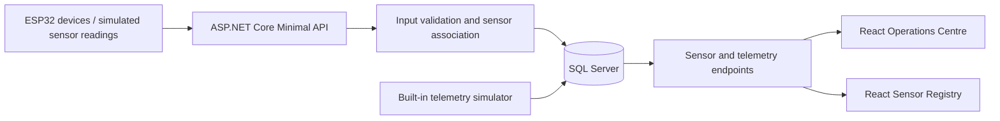

# Smart-X | IoT Telemetry Management Platform

**Smart-X** is a web-based Internet of Things (IoT) monitoring and telemetry management system designed to help operators register connected devices, collect measurements, understand device health, and investigate unusual sensor activity from a central dashboard.

## Purpose

IoT installations may contain hundreds or thousands of distributed sensors generating measurements in different formats. Reading those values one record at a time makes it difficult to detect sudden spikes, identify silent devices, and understand what needs attention.

Smart-X converts raw device data into an accessible operational view. It is intended to:

- Consolidate sensor information and telemetry in one place.
- Support **multiple measurement types**, including floating-point readings, integer power values, and Boolean equipment states.
- Make abnormal measurements and reporting gaps easier to spot.
- Help operators investigate a particular sensor without searching through unrelated readings.
- Demonstrate scalable IoT data-ingestion concepts with simulated devices.

## Application overview

Smart-X has two primary frontend workspaces.

### Operations Centre

The **Operations Centre** is the telemetry-monitoring dashboard. It brings together:

- **Operational summary cards** showing the number of registered devices, currently online devices, offline devices, and anomalies in recently loaded samples.
- **Interactive telemetry charts** for temperature (°C), soil moisture (%), and power usage (W).
- **Sensor-specific investigation**, allowing an operator to select a device and examine its recent measurement history.
- **Attention-needed alerts** for abnormal sample values and devices that are offline or reporting late. Selecting an alert focuses the relevant device.
- **Sensor health directory** with search and category/status filtering.
- **Guided setup checklist** illustrating core steps in preparing a monitored deployment.
- **Automatic dashboard updates**, currently performed by periodic API polling, plus manual refresh.
- **Responsive layouts** for desktop and smaller displays.

The dashboard's current anomaly thresholds are **demonstration rules**, not calibrated safety limits. They illustrate how a monitoring interface can surface unusual activity.

### Sensor Registry

The **Sensor Registry** is the device-management workspace. Operators can:

- Register sensors using a MAC address, deployment location, and category.
- Browse and search registered devices.
- Update sensor details when deployments change.
- Remove a sensor from the registry.

Each registered sensor provides the identity used to associate incoming telemetry with a specific device.

## How Smart-X works



**1. Register devices.** A sensor is added with identifying information such as its MAC address, category, and installation location.

**2. Ingest telemetry.** The API accepts individual readings or batches of readings associated with registered sensor IDs. A reading can contain temperature, soil moisture, power consumption, and actuator state values.

**3. Persist measurements.** Entity Framework Core stores sensors and their telemetry records in SQL Server. Each reading has a timestamp, enabling trend analysis and device-status calculations.

**4. Determine device health.** The backend compares each sensor's latest telemetry timestamp with the current time. In the current prototype, a device is shown as **Online** when its most recent reading is within 30 seconds, **Delayed** within 30–120 seconds, and **Offline** after 120 seconds or when it has never reported.

**5. Visualize and investigate.** The React dashboard fetches recent measurements and device health information. Operators can switch measurements, filter devices, inspect historical readings, and jump from alerts to the affected sensor.

**6. Simulate activity.** The simulator produces batches of category-related sample readings, including a configurable share of deliberately abnormal values. This enables demonstrations of trends, anomalies, and health monitoring without requiring a deployed physical sensor network.


## Data model

### Sensor

A registered IoT device includes:

| Field | Meaning |
|---|---|
| `Id` | Internal sensor identifier |
| `MacAddress` | Device network identifier |
| `Location` | Deployment location, such as a greenhouse or building |
| `Category` | Type of monitoring device |
| `RegisteredAt` | Time the sensor was registered |

### TelemetryRecord

Each telemetry record is linked to a sensor and may contain a mixture of measurement types:

| Field | Type | Example |
|---|---|---|
| `SensorId` | Integer | `1` |
| `Temperature` | Nullable floating-point | `24.8` °C |
| `SoilMoisture` | Nullable floating-point | `62.7` % |
| `Wattage` | Nullable integer | `1430` W |
| `ValveOpen` | Nullable Boolean | `true` |
| `Timestamp` | Date/time | UTC measurement time |

Nullable measurements allow a telemetry message to contain the fields relevant to that sensor rather than requiring every device to report every measurement.

## API capabilities

### Sensor management

| Method | Route | Action |
|---|---|---|
| `GET` | `/api/sensors` | List registered sensors |
| `GET` | `/api/sensors/{id}` | Retrieve one sensor |
| `POST` | `/api/sensors` | Register a sensor |
| `PUT` | `/api/sensors/{id}` | Update sensor details |
| `DELETE` | `/api/sensors/{id}` | Remove a sensor |
| `GET` | `/api/sensors/health` | View calculated device-health states |

### Telemetry

| Method | Route | Action |
|---|---|---|
| `GET` | `/api/telemetry` | Retrieve latest telemetry readings |
| `GET` | `/api/sensors/{sensorId}/telemetry` | Retrieve recent readings for one sensor |
| `POST` | `/api/telemetry` | Ingest one telemetry record |
| `POST` | `/api/telemetry/batch` | Ingest multiple telemetry records |
| `POST` | `/api/telemetry/simulate` | Generate simulated telemetry in batches |

### Example telemetry submission

```json
{
  "sensorId": 1,
  "soilMoisture": 62.7,
  "temperature": 24.8,
  "wattage": 1430,
  "valveOpen": true
}
```

### Example simulation request

```json
{
  "recordCount": 1000,
  "batchSize": 500,
  "anomalyRate": 0.02,
  "liveMode": true
}
```

`recordCount` controls the number of samples, `batchSize` controls how samples are grouped for insertion, and `anomalyRate` controls the approximate proportion of generated abnormal readings. `liveMode` generates recent timestamps for dashboard demonstrations; it does **not** start an ongoing background stream.

## Dashboard design and user engagement

Smart-X is organized around five complementary strategies to support efficient use of a technical monitoring system:

1. **Real-time-oriented visual feedback:** frequently refreshed measurements, trend charts, and clear health states make changing conditions visible.
2. **Proactive alert presentation:** abnormal samples and devices with stale telemetry are surfaced in an attention panel, with direct paths to investigate affected sensors.
3. **Progressive onboarding and contextual guidance:** setup progress and in-dashboard explanations help users understand monitoring tasks and chart signals.
4. **Progress indicators:** a setup checklist makes configuration milestones visible and encourages completion of the monitoring workflow.
5. **User-centred interactive design:** search, filters, focused sensor history, readable summaries, and responsive layouts reduce unnecessary navigation.

The intended troubleshooting journey is simple: **notice a problem → identify the sensor → inspect its recent measurements → decide what to investigate next**.

## Intended use cases

- **Hydroponic farms:** observe temperature and moisture patterns and inspect irrigation actuator states.
- **Smart buildings:** monitor connected devices and investigate unusual consumption or missing telemetry.
- **Energy monitoring:** surface power spikes and review recent wattage trends across deployed devices.
- **Development and demonstrations:** generate representative telemetry volumes, explore dashboard interactions, and demonstrate gateway/data-management concepts without physical hardware.


### Part 2
## Phase 1: Navigation and Application State establishes the frontend foundation for Smart-X's real-time processing and device management features.

### Implemented Features
- **Main Navigation:** Added navigation between Sensor Data Ingestion & Telemetry, Real-Time Command Stream & History, Network Topology & Mesh Routing, and Sensor Registry.
- **Dedicated Module Pages:** Created `CommandStream.jsx` and `NetworkTopology.jsx` as foundations for upcoming functionality.
- **Shared Application State:** Implemented React Context (`AppStateContext.jsx`) to preserve selected sensors, search filters, chart preferences, pagination, and editing selections when navigating between pages.
- **Responsive Interface:** Maintained consistent styling and navigation across desktop and mobile devices.

### Technologies Used
React, React Router, React Context API, JavaScript (JSX), and CSS.

**Outcome:** Smart-X now supports seamless client-side navigation while retaining important user interface settings. This establishes the foundation for real-time command processing, device control, and predictive monitoring in subsequent phases.


## Reference List

**Assignment 1**
GitHubDocs. 2026 Building and testing Node.js [online] Available at: <https://docs.github.com/en/actions/tutorials/build-and-test-code/nodejs > 

Schwarzmuller, M. 2026. React - The Complete Guide (incl. Next.js, Redux). [Online Course] Available at:< https://www.udemy.com/course/react-the-complete-guide-incl-redux/?couponCode=KEEPLEARNING >

Chart.js. 2025. Bar Chart [online] Available at: < https://www.chartjs.org/docs/latest/charts/bar.html >

Choudhary, H. 2026. React - Complete web development course. [Online Course] Available at: < https://www.udemy.com/course/web-dev-master/?couponCode=KEEPLEARNING >

Uppuluri,K. 2024. Mastering ASP.NET Core MVC From Scratch Using C#. [Online Course] Available at:<https://www.udemy.com/course/mastering-aspnetcoremvc/?couponCode=MT261012G1>
